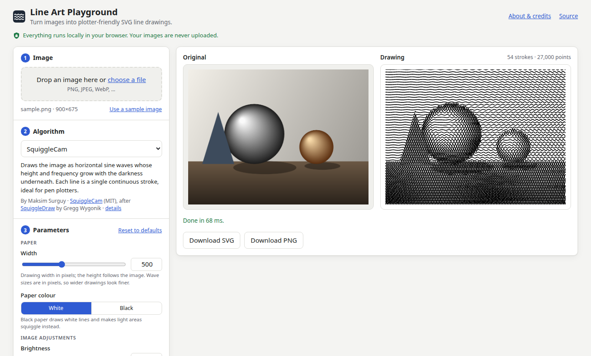

# Line Art Playground

Turn images into plotter-friendly SVG line drawings in the browser. The
playground brings existing open-source line-art algorithms together behind
one interface: upload an image, pick an algorithm, tune its parameters and
download the result as SVG or PNG.

All processing happens locally in your browser. Images are never uploaded.



The site is static and can be deployed to GitHub Pages; see
[Deploying to GitHub Pages](#deploying-to-github-pages). It has not been
published yet.

## Algorithms

| Algorithm       | Original author                                         | Runs as                      | Style                                                                       |
| --------------- | ------------------------------------------------------- | ---------------------------- | --------------------------------------------------------------------------- |
| **SquiggleCam** | [Maksim Surguy](https://github.com/msurguy/SquiggleCam) | TypeScript port, main thread | Horizontal sine waves whose height and frequency follow the image darkness. |
| **linedraw**    | [Lingdong Huang](https://github.com/LingDong-/linedraw) | Original Python, in Pyodide  | Sketchy contour lines plus cross-hatching, ordered for pen plotters.        |

SquiggleCam is a web implementation of
[SquiggleDraw](https://github.com/gwygonik/SquiggleDraw) by Gregg Wygonik.

Many thanks to Lingdong Huang, Maksim Surguy and Gregg Wygonik for creating
and sharing these algorithms. This project is independent; they are not
affiliated with it and do not endorse it.

### Fidelity to the originals

- **linedraw** runs the upstream Python files unmodified
  ([`src/algorithms/linedraw/upstream/`](src/algorithms/linedraw/upstream/)).
  A small wrapper replaces file input and output, adds SVG size attributes and
  seeds the noise so results are reproducible. Tests require the browser build
  to produce exactly the same polylines as unmodified `linedraw.py` run
  natively with the same Pillow, NumPy and OpenCV versions.
- **SquiggleCam** is a line-for-line TypeScript port of its algorithm, without
  the original Vue 2 and Webpack 3 application. Tests compare it with verbatim
  excerpts of the upstream code. Two upstream bugs are fixed: brightness is now
  read from the sampled pixel's own R, G and B values, and images shorter than
  the line count no longer loop forever.

[THIRD_PARTY_NOTICES.md](THIRD_PARTY_NOTICES.md) lists the upstream commits
used and every modification.

### Processing limits

- Images whose longest side exceeds 4096 px are scaled down when loaded; the
  UI shows the processing size. Transparency is flattened onto white.
- SquiggleCam scales the image to the chosen width (200–1000 px).
- linedraw processes at up to 1024 px wide (upstream's fixed resolution).
  Hatch sizes below 8, contour simplification above 4 and processing heights
  above 4096 px are not offered, because upstream's run time grows
  quadratically. Fine settings can still take tens of seconds; runs can be
  cancelled.
- linedraw's first run downloads [Pyodide](https://pyodide.org) from the
  jsDelivr CDN: about 13 MB, plus 14 MB for OpenCV edge detection. The
  pure-Python Sobel option skips OpenCV.

The app needs a current browser with module workers and `OffscreenCanvas`.
Automated tests run in Chromium only.

## Development

Requirements: [Node.js](https://nodejs.org) 22.12 or later, and
[uv](https://docs.astral.sh/uv/) for the Python tooling (it installs the
pinned Python 3.14 itself).

```sh
npm ci                      # install JavaScript dependencies
uv sync                     # install the Python test environment
npx playwright install chromium   # browser for the end-to-end tests

npm run dev                 # development server with hot reload
npm run build               # production build into dist/
npm run preview             # serve the production build
```

### Checks and tests

| Command                                 | What it does                                                        |
| --------------------------------------- | ------------------------------------------------------------------- |
| `npm run typecheck`                     | Strict TypeScript type checking                                     |
| `npm run lint` / `npm run format:check` | ESLint and Prettier                                                 |
| `npm test`                              | Vitest unit tests, including linedraw in Pyodide under Node         |
| `npm run test:e2e`                      | Builds, then runs Playwright smoke tests against `vite preview`     |
| `npm run test:python`                   | pytest: the linedraw wrapper against unmodified upstream in CPython |
| `npm run lint:python`                   | Ruff lint and format checks                                         |
| `npm run fixtures:linedraw`             | Regenerates linedraw reference outputs from upstream                |

`npm test` downloads Pyodide packages from the CDN on its first run and
caches them in `node_modules/pyodide`.

The linedraw reference outputs in `tests/fixtures/linedraw/` are produced by
unmodified upstream code with the Pillow, NumPy and OpenCV versions of the
pinned Pyodide release. After upgrading Pyodide, update the pins in
`pyproject.toml` to its `pyodide-lock.json`, run `uv sync` and
`npm run fixtures:linedraw`, and review the changes.

The end-to-end tests serve the build under `/line-art-playground/`, as GitHub
Pages does, and exercise both algorithms, including Pyodide start-up.

### Project structure

```text
src/
  algorithms/        algorithm contract, parameter handling, registry
    squigglecam/     TypeScript port and adapter
    linedraw/        adapter, Python wrapper and vendored upstream/
  runtimes/pyodide/  Web Worker that runs Python calls in Pyodide
  app/               user interface
  utils/             shared helpers (image resampling)
tests/
  unit/              Vitest tests
  python/            pytest tests and the linedraw reference generator
  e2e/               Playwright smoke tests
  fixtures/          generated test inputs and reference outputs
  reference/         verbatim upstream code used as a test oracle
docs/                developer documentation
```

To add an algorithm, see [docs/adding-an-algorithm.md](docs/adding-an-algorithm.md).

## Deploying to GitHub Pages

The workflow in [`.github/workflows/ci.yml`](.github/workflows/ci.yml) runs all
checks on pushes and pull requests, and on pushes to `main` deploys `dist/` to
GitHub Pages. The build uses relative URLs, so it works under any repository
name. To publish:

1. Create an empty GitHub repository, e.g. `line-art-playground`, and push this
   repository's `main` branch to it.
2. In the repository settings under **Pages**, set **Source** to
   **GitHub Actions**.
3. Re-run the workflow, or push to `main`. The site is then served at
   `https://<user>.github.io/<repository>/`.

The page links to the source repository at
`https://github.com/saeedghsh/line-art-playground`; change those links in
`index.html` if you use a different name.

## License

The playground's own code is released under the [MIT License](LICENSE).
linedraw (Copyright (c) 2017 Lingdong Huang) and SquiggleCam (Copyright (c)
2019 Maksim Surguy) are MIT-licensed; their license texts are kept in
[`src/algorithms/linedraw/upstream/LICENSE`](src/algorithms/linedraw/upstream/LICENSE),
[`src/algorithms/squigglecam/LICENSE`](src/algorithms/squigglecam/LICENSE) and
[THIRD_PARTY_NOTICES.md](THIRD_PARTY_NOTICES.md), which also covers the
runtime dependencies loaded from the CDN.
